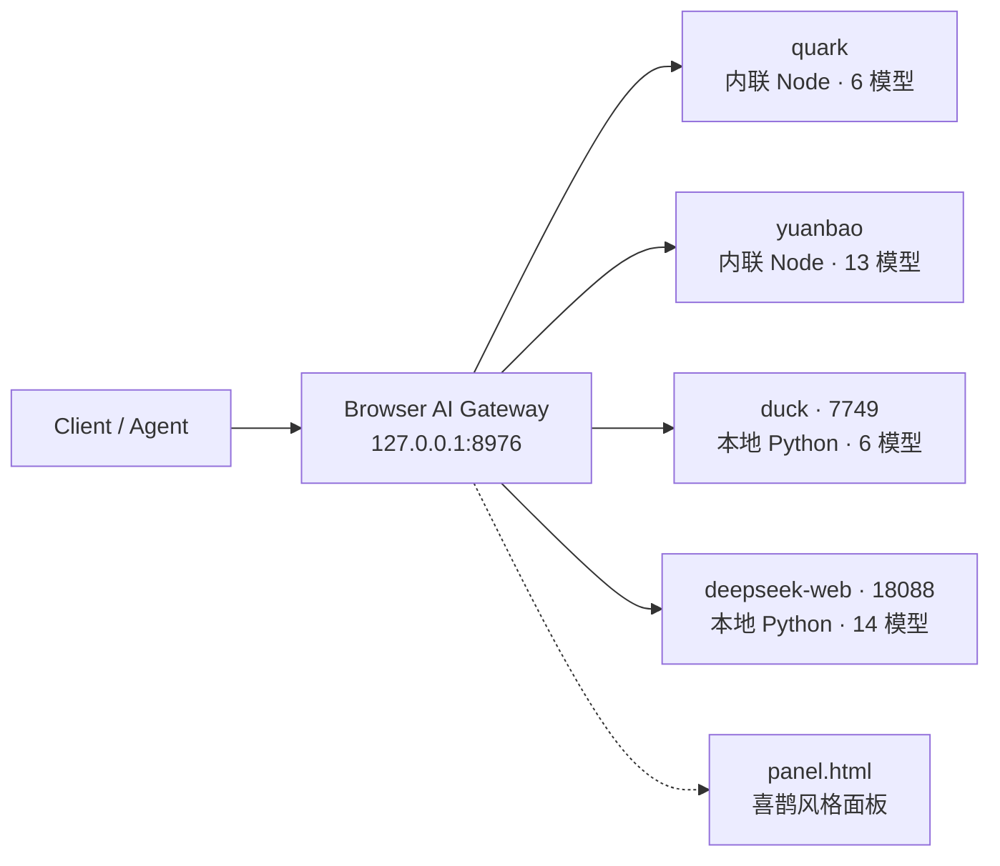

<div align="center">

# 🧠 Browser AI Gateway

**一个进程 · 一个端口 · 四个浏览器内置 AI · 一套 OpenAI 兼容接口**

[](https://nodejs.org/)
[](https://www.python.org/)
[](https://platform.openai.com/docs/api-reference)
[](#-四个分组)
[](#-四个分组)
[](https://github.com/laolaola278-dev/browser-ai-proxy)

</div>

> **给谁看**：想在本机把几个「浏览器内置 AI」收拢成单一接口的开发者。
> **包含什么**：`server.mjs`（分组路由 + 统计）、`panel.html`（喜鹊风格面板）、`gateways/`（三个网关源码）、`standalone/`（早期独立代理快照）。
> **一句话**：无需登录、无需打开浏览器、无需票据刷新，源码全部自包含。

---

## 📌 目录

| | |
|---|---|
| [🧭 它是什么](#overview) | [🚀 安装与启动](#start) |
| [🧩 四个分组](#groups) | [💻 用法](#usage) |
| [⚙️ 配置](#config) | [📁 项目结构](#structure) |
| [⚠️ 边界与已知限制](#limits) | [✅ 实测记录](#tests) |
| [📚 逆向报告](#reports) | [🧾 免责](#disclaimer) |

---

<a id="overview"></a>

## 🧭 它是什么

四个来源完全不同的浏览器 AI，被收敛成同一个 `POST /v1/chat/completions`：



- **内置分组**（`quark` / `yuanbao`）：协议直接内联在 Node 里，随网关启动即可用。
- **本地托管分组**（`duck` / `deepseek-web`）：源码随仓库自带，由网关按 `launch` 配置拉起 Python 子进程，仍通过本地 OpenAI 兼容端口转发。
- 每组独立配置、独立开关、独立健康检查（15 秒轮询）、独立统计；模型 id 一律 `<组名>/<模型>`。

---

<a id="start"></a>

## 🚀 安装与启动

### 依赖

| 组件 | 要求 |
|---|---|
| Node.js | 24.x（仅内置分组与网关本体） |
| Python | 3.10+，`requests` / `urllib3`（本地托管分组） |
| 可选 | Node.js 求解挑战、Playwright + Chrome（duck `--transport browser`） |

### 一键启动（推荐）

双击桌面 **`启动BrowserAI全部.cmd`**（仓库内有同名副本）：

1. 检测并启动统一网关（若 8976 未监听）；
2. 通过 `/api/groups/:id/start` 拉起 `duck` / `deepseek-web` 两个本地 Python 网关（端口已占用会返回 `already:true`，不会重复启动）；
3. 打印四组状态并打开面板。

只启动网关本体（不含两个 Python 子进程）：双击桌面 **`browser-ai-proxy.cmd`**。

```bash
# 等价于手动启动
node server.mjs                      # 统一网关，监听 127.0.0.1:8976
python gateways/duck/duck2api_proxy.py --host 127.0.0.1 --port 7749 --tools emulated
python gateways/deepseek-web/_run_live_proxy_new.py   # 端口 18088
```

> 服务在后台运行，关闭脚本窗口不影响；换机时先复制 `config.example.json` 为 `config.json` 并填好 `launch.python`。

---

<a id="groups"></a>

## 🧩 四个分组

| 分组 | 类型 | 来源 / 上游 | 端口 | 模型 | 状态 |
|---|---|---|---|---|---|
| `quark` | 内置 Node | 夸克浏览器 quarkchat `/api/v2/chat` | — | 6 | ✅ 可用 |
| `yuanbao` | 内置 Node | QQ 浏览器元宝助手 `qbot/qa` | — | 13 | ✅ 可用 |
| `duck` | 本地托管 | `gateways/duck/`（duck.apk 重建） | 7749 | 6（动态） | ✅ 可用 |
| `deepseek-web` | 本地托管 | `gateways/deepseek-web/`（`laolaola278-dev/DeepSeekWebProxy`） | 18088 | 14（动态） | ⚠️ 上游登录态过期 |

合计 **39 个模型**。备用实现 `gateways/duckpro/`（`laolaola278-dev/duck2api-pro`，默认 7750，含身份池与 `/v1/responses|messages|images/generations`）也已收录，改 `launch` 与 `baseURL` 即可切换。

> ⚠️ `duck2api-pro` 是**另一个更新的项目**，不是 7749 上部署的网关；不要按它的端点给 7749 配路由。

---

<a id="usage"></a>

## 💻 用法

### OpenAI 兼容接口

| 方法 | 路径 | 说明 |
|---|---|---|
| `GET` | `/health` | 状态 |
| `GET` | `/v1/models` | 39 个模型（按分组） |
| `POST` | `/v1/chat/completions` | 按 `model` 前缀路由；裸 id（如 `smart`、`Qwen`）与 `auto` 也可用 |

```bash
curl http://127.0.0.1:8976/v1/models

curl -X POST http://127.0.0.1:8976/v1/chat/completions \
  -H "Content-Type: application/json" \
  -d "{\"model\":\"quark/Qwen\",\"messages\":[{\"role\":\"user\",\"content\":\"只回复 PONG\"}]}"
```

```json
{
  "id": "chatcmpl-...",
  "object": "chat.completion",
  "model": "quark/Qwen",
  "provider": "quark",
  "choices": [{ "index": 0, "message": { "role": "assistant", "content": "PONG" }, "finish_reason": "stop" }],
  "usage": { "prompt_tokens": 0, "completion_tokens": 0, "total_tokens": 0 }
}
```

支持 `stream:true`（一次性 chunk）；响应额外带 `provider` 字段。

### 🖥️ 前端面板

打开 `http://127.0.0.1:8976/`，纯静态单文件 `panel.html`，5 秒自动刷新。布局参考喜鹊 magpie（Wails 桌面面板）：

| 区域 | 内容 |
|---|---|
| 侧栏 | 模型（供应商 / 路由 / 网关）· 观测（用量）· 扩展，底部网关状态灯 |
| 供应商 | 图标 + 名称徽章 + `域名 · N models` + 脱敏 key 药丸 + 在线灯 + 启用开关 + 展开箭头（健康检查 / 启动脚本 / 启动按钮 / token 过期红标） |
| 路由 | SVG 三层拓扑（Agent → 网关 → 各分组）+ 路由策略卡 |
| 网关 | 本体信息 + 各组健康检查 + 接口清单 |
| 用量 | 概览 / 请求双页签、4 列 KPI、按分组柱状图、按模型折叠排行、16 列请求表、CSV 导出、53 周热力图 |
| 视觉 | 亮 / 暗主题、`#4f46e5` 主色、12px 卡片、999px 药丸、`tabular-nums`、耗时色（≤10s 绿 / 10–30s 琥珀 / >30s 红） |

### 管理与统计 API

| 路径 | 用途 |
|---|---|
| `GET /api/status` · `/api/state` | 分组状态 |
| `GET /api/models` | 模型清单 |
| `GET /api/stats` · `/api/usage` | 请求数 / Token / 成功率 / 耗时 |
| `GET /api/requests` · `/api/usage/requests` | 最近请求 |
| `GET /api/providers` | 供应商摘要 |
| `GET /api/requests.csv` | CSV 导出 |
| `POST /api/groups/:id/toggle` | 启用 / 禁用分组 |
| `POST /api/groups/:id/start` | 启动本地托管网关 |

---

<a id="config"></a>

## ⚙️ 配置

`config.json`（本机，**已被忽略**）字段：

| 字段 | 说明 |
|---|---|
| `port` | 监听端口，默认 `8976` |
| `defaultProvider` | 默认分组，建议保持 `quark` |
| `quark.ut` | 夸克设备固定串，**唯一必需值**（`chrome.publicParamsPrivate.ucParams("ut")`） |
| `yuanbao.qua` / `guid` / `qimei` | QUA2 与设备指纹；留空则每次启动随机生成并自动轮换 |
| `groups.<id>.type` | `builtin`（内联）或 `local`（本地托管） |
| `groups.<id>.baseURL` / `health` / `key` | 上游地址、健康检查、鉴权 |
| `groups.<id>.launch` | `python` / `cwd` / `script` / `args` / `env` / `port`，用于一键启动 |

环境变量覆盖：`BAI_PORT`、`BAI_CONFIG`、`BAI_PYTHON`、`QW_UT`、`YB_GUID`、`YB_QIMEI`、`YB_QUA`。

脱敏模板见 [config.example.json](config.example.json)。

---

<a id="structure"></a>

## 📁 项目结构

```text
browser-ai-proxy/
├── server.mjs                # 统一代理：分组路由、统计、面板 API
├── panel.html                # 喜鹊风格面板（亮 / 暗主题）
├── config.example.json       # 脱敏配置模板
├── config.json               # 本地配置（含 ut，已忽略）
├── 启动BrowserAI全部.cmd      # 桌面一键启动（仓库副本）
├── .gitignore
├── gateways/
│   ├── README.md             # 网关源码、依赖与凭证说明
│   ├── deepseek-web/         # DeepSeekWebProxy（13 文件）
│   ├── duck/                 # duck.apk 重建网关（8 文件）
│   └── duckpro/              # duck2api-pro（5 文件，备用实现）
└── standalone/
    ├── quark/                # 早期独立代理源码快照
    ├── yuanbao/
    └── launchers/            # 两个桌面启动脚本快照
```

---

<a id="limits"></a>

## ⚠️ 边界与已知限制

### 上游状态（不是本项目故障）

- **`deepseek-web`**：`health.token_status = expired`，实测对话返回上游 401；调研记录 2026-11-09 起账号被封 9 天。**高风险，不要设为默认**。恢复需重新登录 chat.deepseek.com 或 `POST /_set_token`，并提供 `DEEPSEEK_TOKEN`。
- **`duck`**：仅 5 个端点，模型目录动态（上游 30 分钟缓存，失败回落 `models-extracted.json`）；纯文本、不支持图片 / 联网；上游靠 `X-Vqd-Hash-1` 挑战；451 需海外出口。本地 curl 建议 `--noproxy "*"`。
- **`quark`**：上游偶发 `403 EX015 签名错误`（概率性），代理内置 **10 次自动重试**（每次换 ID、间隔 300ms）。

### 凭证安全

- 仓库**不含任何真实 API Key / Token / 设备标识 / WG 票据**：`config.json`、`ticket.json`、`deepseek_token.txt`、`cookie_keys.txt`、`deepseek_device_id.txt`、`*.pid` 均被排除。
- 元宝设备指纹运行时随机生成；夸克 `ut` 只从被忽略的本地配置读取；Duck 挑战 token 运行时计算不落盘。
- 公开仓库匿名复核：41 个文件，0 个凭证文件。

### 其它边界

- **无状态**：每次请求独立会话，完整 `messages` 拼成一段 prompt；`stream:true` 为一次性 chunk，不是逐 token 真流式。
- **统计为估算**：Token 按字符数 / 4 估算，费用恒 0，数据仅存内存（重启清空）。
- **早期独立代理** `quark-qwen-proxy`(8965) / `yuanbao-proxy`(8966) 仍在本机可用，统一代理不依赖它们。

---

<a id="tests"></a>

## ✅ 实测记录

> 采样日期：2026-11-11

| 项目 | 结果 |
|---|---|
| `quark/Qwen` 连续 8 次（含 stream） | ✅ 全部 200 + PONG |
| `yuanbao/smart` · `yuanbao/hunyuan` | ✅ 200 + PONG |
| `duck/gpt-6-luna` | ✅ 200 + PONG |
| `deepseek-web/deepseek-chat` | ⚠️ 上游 401（登录态过期） |
| 项目内 Duck 启动（备用端口 7751） | ✅ health 200、6 模型 |
| 项目内 duckpro 启动（7752） | ✅ health 200、身份池正常、6 模型 |
| 项目内 DeepSeek 启动（18188） | ✅ health 200、14 模型 |
| 10 个 Python 文件语法 / 两套 selftest | ✅ 0 错误、全部通过 |
| 桌面一键脚本 | ✅ 已实际运行验证 |

---

<a id="reports"></a>

## 📚 逆向报告

完整报告与调研笔记在**本机**（未纳入仓库，避免公开过多协议细节）：

- `E:\hds(js)\look\quark-re\REPORT.md` — 夸克 Qwen 签名消融、native 票据链、最小必需参数集
- `E:\hds(js)\look\qq-re\REPORT.md` — 元宝助手协议与模型可用性
- `E:\hds(js)\look\qq-re\research\gateways.md` — 两个网页版网关 7 节规格
- `E:\hds(js)\look\qq-re\research\magpie-ui.md` — 喜鹊面板布局 / 配色 / API 调研

---

<a id="disclaimer"></a>

## 🧾 免责

本项目为个人学习与技术研究所作，仅在本机 `127.0.0.1` 监听。使用各上游服务时请遵守其服务条款；账号、Token 与设备标识均由使用者自行准备，作者不提供也不分发任何凭证。

<div align="center">

**[laolaola278-dev/browser-ai-proxy](https://github.com/laolaola278-dev/browser-ai-proxy)** · 公开仓库 · 欢迎 issue

</div>
