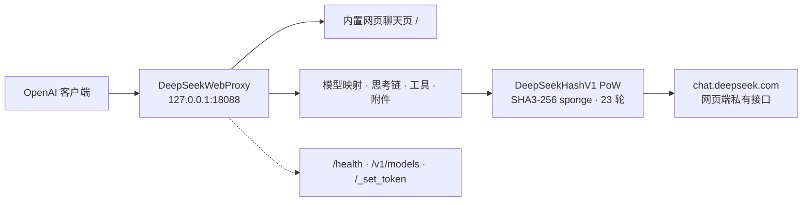

<div align="center">

# 🐋 DeepSeekWebProxy

**把 chat.deepseek.com 网页版封装成本地 OpenAI 兼容 API**

[](https://www.python.org/)
[](https://pypi.org/project/requests/)
[](https://platform.openai.com/docs/api-reference)
[](PATCH_NOTES-20261110.md)
[](#-快速开始)
[](#%EF%B8%8F-边界与安全)

</div>

> **给谁看**：想把 DeepSeek 网页版会话接成 OpenAI 接口的开发者（**仅限个人学习与研究**）。
> **模块**：`MODIFIED_FILE.py`（单文件代理）· `start_proxy.py`（跨平台启动器）· `_desktop_start.py`（Windows 看门狗）· `_pow_node.js`（可选 PoW 加速）。
> **前置条件**：Python 3.9+、一个已登录 chat.deepseek.com 的账号 `userToken`。纯 Python（标准库 + `requests`），**不需要浏览器自动化，也不需要官方 API Key**。

> [!CAUTION]
> **🚨 账号封禁实测警告（2026-11-10）**
>
> 调用 `chat.deepseek.com` 网页端私有接口**会触发上游风控**：实测账号被**直接封禁 9 天**，再次触发可能更长，直至永久停用。内置 `upstream_pacing`（并发 2 / 最小间隔 800 ms / 重试 2）**不能保证免封**。
>
> ⚠️ **请勿使用主力账号**，也不要挂进长期在线的自动化流程。完整实测与降风险建议见 [ACCOUNT-BAN-RISK.md](<ACCOUNT-BAN-RISK.md>)。

---

## 📌 目录

| | |
|---|---|
| [🧭 它是什么](#overview) | [🚀 快速开始](#start) |
| [✨ 功能](#features) | [🔌 API](#api) |
| [⚙️ 环境变量](#env) | [📁 目录结构](#files) |
| [⚠️ 边界与安全](#limits) | [🙏 致谢与参考](#credits) |

---

<a id="overview"></a>

## 🧭 它是什么

一个本地反向代理：OpenAI 格式的请求进来，翻译成网页端私有接口（含 PoW 挑战、会话状态机、DSML 工具协议）再发出去，最后把 SSE 流转回 OpenAI 格式。



---

<a id="start"></a>

## 🚀 快速开始

### 1. 准备环境

要求 **Python 3.9+**；Windows 看门狗脚本另需 `psutil`（已在 `requirements.txt` 按平台声明）。

```bash
python -m pip install -r requirements.txt
```

### 2. 取得 userToken

在浏览器登录 <https://chat.deepseek.com> → DevTools → Application → Local Storage → 复制 `userToken`（一长串字符串）。三选一提供：

```bash
export DEEPSEEK_TOKEN="你的userToken"        # Linux / macOS（推荐）
set DEEPSEEK_TOKEN=你的userToken             # Windows CMD
$env:DEEPSEEK_TOKEN="你的userToken"          # PowerShell

echo 你的userToken > deepseek_token.txt      # 方式 B：同目录文件（已被忽略）

curl -X POST http://127.0.0.1:18088/_set_token \
  -H "Content-Type: application/json" \
  -d "{\"token\":\"你的userToken\"}"   # 方式 C：启动后热替换
```

> 令牌解析顺序：环境变量 `DEEPSEEK_TOKEN` → 同目录 `deepseek_token.txt`。

### 3. 启动

```bash
python start_proxy.py --port 18088 --host 127.0.0.1   # 跨平台启动器（推荐）
python MODIFIED_FILE.py --port 18088 --host 127.0.0.1 # 直接运行主程序
python MODIFIED_FILE.py --selftest                     # 自检，不需要网络 / 令牌
```

Windows 可双击 `start_deepseek_18088.cmd` 后台启动（自动探测 `pythonw.exe`），或运行 `python _desktop_start.py` 拉起看门狗。

---

<a id="features"></a>

## ✨ 功能

| 能力 | 说明 |
|---|---|
| OpenAI 兼容 | `POST /v1/chat/completions`（流式 SSE / 非流式）、`GET /v1/models` |
| PoW | 内置 `DeepSeekHashV1`（SHA3-256 sponge，23 轮）纯 Python 实现；可选 `_pow_node.js` + Node 加速（`DEEPSEEK_POW_NODE`） |
| 模型映射 | `deepseek-chat → default`；`deepseek-reasoner` / `deepseek-r1` / `deepseek-thinking → expert` |
| 思考链 | `reasoning_content` 独立输出，`include_thinking` 开关 |
| 工具调用 | OpenAI `tools` / `tool_choice` → DSML `<｜tool▁calls▁begin｜>` 增量解析，支持跨 chunk 拆包与 `finish_reason: tool_calls` |
| 附件 | `image_url` / `file`（data URL、裸 base64、http(s)）→ `upload_file` → `fetch_files` 轮询 → `ref_file_ids` |
| 回合状态机 | `INCOMPLETE → /chat/continue`（最多 20 次）、空 `FINISHED → /chat/resume_stream`、非 SSE 的 `biz_code 22` 整包解包 |
| 会话失效自愈 | 自动新开 chat session + 全量历史重发一次 |
| 令牌自愈 | `40003 INVALID_TOKEN` 时自动重扫 Chromium Local Storage、验活并热替换，无需重启 |
| 上游限速 | 并发闸门 + 最小请求间隔 + 指数退避重试（**不保证免封**） |
| finish_reason | `CONTENT_FILTER → content_filter`；`INCOMPLETE / TIMEOUT / CONTEXT_LENGTH_EXCEEDED → length` |
| 内置网页 | 简易聊天页 `http://127.0.0.1:18088/` |

---

<a id="api"></a>

## 🔌 API

**Base URL**：`http://127.0.0.1:18088/v1` — 任意 API Key 均可，服务端不校验。

| 路径 | 说明 |
|---|---|
| `GET /` | 内置网页聊天页 |
| `GET /health` · `GET /deepseek/health` | 健康检查（含 `token_status`、限流参数） |
| `GET /v1/models` · `GET /deepseek/v1/models` | 模型目录 |
| `POST /v1/chat/completions` · `POST /deepseek/v1/chat/completions` | 聊天补全 |
| `POST /_set_token` | 热替换 token |

```bash
curl -X POST http://127.0.0.1:18088/v1/chat/completions \
  -H "Content-Type: application/json" \
  -H "Authorization: Bearer x" \
  -d "{\"model\":\"deepseek-chat\",\"messages\":[{\"role\":\"user\",\"content\":\"你好\"}],\"stream\":false}"
```

工具调用与图片 / 文件附件按 OpenAI 格式传入即可：

```json
{
  "model": "deepseek-chat",
  "messages": [{"role": "user", "content": [
    {"type": "text", "text": "这张图里是什么？"},
    {"type": "image_url", "image_url": {"url": "data:image/png;base64,..."}}
  ]}],
  "tools": [{"type": "function", "function": {"name": "get_time", "parameters": {"type": "object", "properties": {}}}}]
}
```

---

<a id="env"></a>

## ⚙️ 环境变量

完整清单见 [`.env.example`](<.env.example>)。常用项：

| 变量 | 默认值 | 说明 |
|---|---|---|
| `DEEPSEEK_TOKEN` | — | 网页版 userToken |
| `DEEPSEEK_DEVICE_ID` | 随机 | `did` 设备标识 |
| `DEEPSEEK_BASE` | `https://chat.deepseek.com` | 上游地址 |
| `DEEPSEEK_HOST` / `DEEPSEEK_PORT` | `127.0.0.1` / `18088` | 本地监听 |
| `DEEPSEEK_POW_NODE` / `DEEPSEEK_POW_JS` | — | 可选 Node PoW 加速器 |
| `DEEPSEEK_MAX_CONCURRENCY` | `2` | 上游并发上限 |
| `DEEPSEEK_MIN_INTERVAL_MS` | `800` | 上游请求最小间隔 |
| `DEEPSEEK_MAX_RETRIES` | `2` | 退避重试次数 |
| `DEEPSEEK_MAX_CONTINUES` | `20` | `/chat/continue` 最大次数 |
| `DEEPSEEK_INCLUDE_THINKING` | `0` | 默认是否输出思考链 |
| `DEEPSEEK_TOKEN_REFRESH_COOLDOWN` | `60` | 令牌重扫冷却（秒） |

---

<a id="files"></a>

## 📁 目录结构

| 文件 | 作用 |
|---|---|
| `MODIFIED_FILE.py` | 代理主程序（单文件：内置网页、PoW、状态机、工具调用、附件） |
| `start_proxy.py` | 跨平台启动器（自动读取 env / token 文件） |
| `_pow_node.js` | 可选 Node PoW 加速器 |
| `_desktop_start.py` / `_watch_deepseek_18088.py` / `_run_live_proxy_new.py` | Windows 后台看门狗（可选） |
| `start_deepseek_18088.cmd` | Windows 启动脚本（自动探测 Python） |
| `PATCH_NOTES-20261110.md` | 与参考实现逐项对比的改动与验证记录 |
| `ACCOUNT-BAN-RISK.md` | 账号风控 / 封禁实测记录与降风险建议 |

---

<a id="limits"></a>

## ⚠️ 边界与安全

> [!WARNING]
> **封号风险（实测）**：使用本代理会触发上游风控，已发生账号被封禁 **9 天** 的案例，后续可能更长直至永久停用。封的是**网页版账号本身**，不是某个 API Key；换 token ≠ 换账号。已被封禁时请**立即停止一切请求、等待解封**，不要反复换 token 试探。详见 [ACCOUNT-BAN-RISK.md](<ACCOUNT-BAN-RISK.md>)。

- **降风险建议（只能降低概率，不能保证免封）**：绝不用主力账号；保持低频低并发；不跑批量探测 / 循环健康检查 / 压测；不 7×24 挂在 Agent 里当默认模型，用完即停；关注 `token_status`，出现 `INVALID_TOKEN` 或频繁 401/403 立即停止，别靠自动重扫硬扛；同一账号不要同时跑多个代理实例。
- **凭证不进仓库**：`deepseek_token.txt` / `deepseek_device_id.txt` 已被 `.gitignore` 排除，根目录采用白名单式忽略规则，防止误提交抓包与凭据文件。账号 `userToken` 属于个人凭据，**绝对不要提交**。
- **令牌自愈的边界**：令牌失效返回清晰的 `401 authentication_error`，并尝试从本机 Chromium 存储自动验活、热替换；但「重扫」不等于「换账号」，被封期间反复重扫只会持续触发风控。
- **上游改版风险**：内置 PoW、请求头、模型 ID 均可能随上游改版失效，属预期情况。
- **用途限制**：本项目是对网页端私有接口的逆向实现，仅供个人学习与研究；请遵守 DeepSeek 服务条款，使用后果由使用者承担。

---

<a id="credits"></a>

## 🙏 致谢与参考

协议细节与状态机设计参考 [`volcanicll/magpie-deepseek-web-auth`](https://github.com/volcanicll/magpie-deepseek-web-auth)。本仓库的实现差异、修复项与验证记录见 [PATCH_NOTES-20261110.md](<PATCH_NOTES-20261110.md>)。

<div align="center">

**公开仓库** · 仅供个人学习与研究 · 请遵守 DeepSeek 服务条款

</div>
